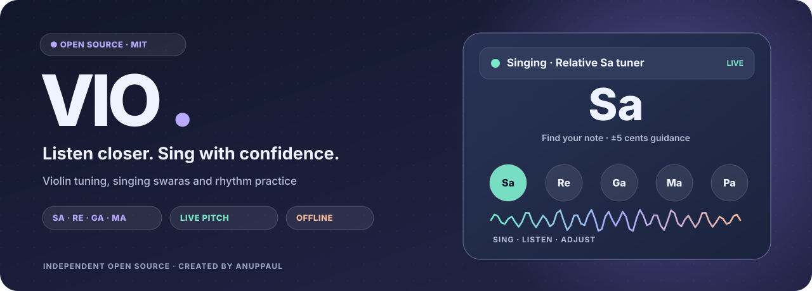
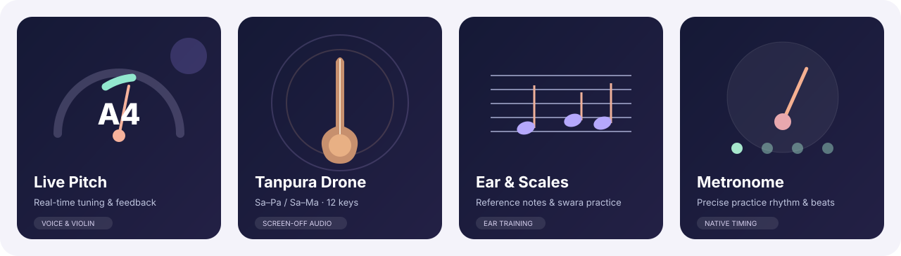
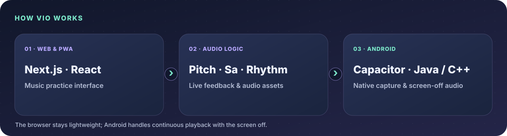

<div align="center">



<br/>

[](LICENSE)


**An open-source practice toolkit for violinists, students, teachers, and curious musicians.**

[Explore features](#the-practice-studio) · [Run locally](#quick-start) · [Build Android](#android-apk) · [Contribute](CONTRIBUTING.md) · [License](#license--audio-rights)

</div>

> [!IMPORTANT]
> **Audio licensing notice:** VIO's original project code and SVG artwork are offered under MIT. Some bundled audio recordings have **uncleared third-party provenance** and are **not licensed by this MIT grant**. The original source references are retained in Git history for an accurate rights review. **Do not redistribute those recordings or publish an APK that includes them until the rights are confirmed or the assets replaced.** Read [Asset licensing & provenance](docs/ASSET_LICENSING.md) before distributing a fork or binary.

---

## The practice studio

VIO brings essential pitch and rhythm tools into one focused interface, designed around intentional music practice rather than account setup or cloud services.



| Module | What it does |
| :--- | :--- |
| **Ear Tuner** | Reference notes for violin strings, alternate tunings, natural samples, and clean oscillator tones. |
| **Sound Tuner** | Live microphone pitch detection with note, frequency, cents deviation, and signal confidence feedback. |
| **Scale Practice** | Set your *Sa* reference, practise swaras and intervals, and get live pitch feedback. |
| **Tanpura** | Choose Sa–Pa or Sa–Ma, one of 12 keys, and control the drone's volume. |
| **Note Exercise** | Read notes, answer exercises, configure difficulty, and track session performance. |
| **Metronome** | Tempo presets, beats per bar, subdivisions, accents, and click/tabla/drum sounds. |

### Designed for real practice

- **Offline-capable:** Android packages the interface and audio assets; the web/PWA can use its locally available resources.
- **Microphone-first tuning:** Input is analysed on-device, not uploaded to a server by VIO's tuner.
- **Screen-off practice on Android:** User-started Tanpura, Ear Tuner, and Metronome playback runs through a native foreground media service with notification controls.
- **Graceful fallbacks:** Android microphone capture can fall back from native Oboe to AudioRecord; browser features use Web Audio fallbacks when appropriate.
- **Open development:** Source code, tests, architectural notes, and contribution guidelines live in this repository.

> [!NOTE]
> The SVG panels above are **illustrations**, not screenshots of a particular build. Audio accuracy, battery use, and native background behaviour vary by device and should be measured rather than assumed.

## Platforms and architecture



| Layer | Stack | Responsibility |
| :--- | :--- | :--- |
| Web application | Next.js 16 · React 19 · TypeScript | Pages, practice UI, and static exports |
| Browser audio | Web Audio API · Pitchy | Reference playback, pitch tracking, and PWA features |
| Android shell | Capacitor 8 · Java · C++ | Native permissions, bundled web assets, device integration |
| Native capture | Oboe / AAudio · AudioRecord | Android microphone streaming with fallback |
| Screen-off playback | Android foreground service · MediaPlayer · AudioTrack | Background drone, note, and rhythm playback |

**Privacy and behaviour:** VIO's core practice tools do not require a login. Android playback is explicitly started by the user. The background audio service does **not** keep the screen awake, and microphone capture is stopped when the Android Activity pauses. The Android app declares the permissions needed for microphone capture, media playback, notifications, and audio wake locks; see [Screen-off audio architecture](docs/ANDROID_SCREEN_OFF_AUDIO.md).

## Quick start

### Prerequisites

- **Node.js 22** and npm
- A current Chromium-, Firefox-, or WebKit-based browser
- Permission to use the microphone for live tuner pages
- HTTPS or localhost when using microphone APIs

```bash
git clone https://github.com/Anuppaul/vio.git
cd vio
npm ci
npm run dev
```

Open **http://localhost:3000** to use the development app.

To generate the production web build:

```bash
npm run build
```

The hosted web build and the Android offline export use separate build settings. For a static Android export, run `npm run build:android:web` instead.

## Android APK

The Android variant wraps VIO's offline export in a Capacitor app. The native microphone and screen-off audio modules live under `android/app/src/main/`.

**Build prerequisites:** Node.js 22, **JDK 21**, Android SDK Platform **36** with Build Tools **36.0.0**, compatible Android NDK/CMake, and **FFmpeg + FFprobe** for the compact Tanpura assets. Set `ANDROID_HOME` or `ANDROID_SDK_ROOT`.

```bash
npm ci
npm run test:android:thermal
npm run test:android:background
npm run android:apk
```

The build exports the web UI, compacts bundled Tanpura files, runs Capacitor sync, compiles and tests Android, verifies APK signing, and writes a debug APK and checksum to `release/`.

**Debug builds are for local testing only.** Do not treat a previously committed APK as an up-to-date or rights-cleared release. To make a production release, first complete [the publication checklist](docs/OPEN_SOURCE_RELEASE_CHECKLIST.md), use a stable private signing key, and publish a tagged GitHub Release.

### Android playback lifecycle

| Situation | Intended behaviour |
| :--- | :--- |
| Start Tanpura, lock phone | Native playback continues with a foreground notification |
| Start Metronome, switch apps | Native rhythm generation continues |
| Play a looping Ear Tuner note | Native reference sound continues |
| Tap notification Pause / Play / Stop | Playback state changes without opening VIO |
| Stop playback | Audio stream, foreground service and associated resources shut down |
| Leave a live microphone tuner | Microphone capture stops to avoid background recording |

Screen-off acceptance was tested by the maintainer on a phone; broader device coverage, audio-focus edge cases and long-duration battery benchmarks remain welcome contributions.

## Development and quality checks

```bash
# Deterministic pitch-tracking regression cases
node scripts/run-tuner-regression.mjs

# Check community files, attribution and release guardrails
npm run audit:opensource

# Android lifecycle/source contracts
npm run test:android:thermal
npm run test:android:background

# Browser smoke tests — run after generating Android's web export
npm run build:android:web
npm run test:android:web
```

Some checks require **Playwright Chromium** (`npx playwright install chromium`), while Android packaging additionally needs the SDK/NDK toolchain. A passing source audit is not a replacement for real-device latency, accuracy, battery, interruption, or screen-lock testing.

### Repository map

```text
app/                 Next.js App Router pages and styles
components/          Ear Tuner, Sound Tuner, Scale Practice, Tanpura,
                     Note Exercise, and Metronome
lib/                 Pitch/audio utilities and native bridges
android/             Capacitor Android host, Java services, and C++
public/              Web assets, worklets, and bundled sound files
scripts/             Build, sync, audio processing, and regression tests
docs/                Architecture, test notes, and asset provenance
docs/assets/         Original SVG README illustrations
.github/             Community templates and manual CI workflows
```

## Roadmap and contributions

Contributions are welcome for musical accuracy, device accessibility, resource efficiency, documentation, translations, and original/licensed audio replacements. The most important **release blocker** is proving or replacing the provenance of the shipped reference recordings.

Before opening a pull request, read [CONTRIBUTING.md](CONTRIBUTING.md), [CODE_OF_CONDUCT.md](CODE_OF_CONDUCT.md), and [SECURITY.md](SECURITY.md). For usage questions, use GitHub Discussions if enabled or open a suitably labelled issue.

## License & audio rights

**Copyright © 2026 Anuppaul.** The project's original source code, documentation and newly created SVG branding are licensed under the **[MIT License](LICENSE)**.

**Not all files in the repository are necessarily MIT-licensed.** Third-party dependencies retain their own licenses; audio recordings whose rights are not established are **excluded** from the project's MIT grant. Read [ASSET_LICENSING.md](docs/ASSET_LICENSING.md) and [THIRD_PARTY_NOTICES.md](THIRD_PARTY_NOTICES.md) before modifying, redistributing, or packaging those files. Publishing a repository does not automatically grant redistribution rights to third-party media.

<div align="center">

**Created and maintained by [Anuppaul](https://github.com/Anuppaul)**

Made for focused practice, careful listening, and musicians who love to learn.

[Report an issue](https://github.com/Anuppaul/vio/issues) · [View source](https://github.com/Anuppaul/vio) · [MIT License](LICENSE)

</div>
